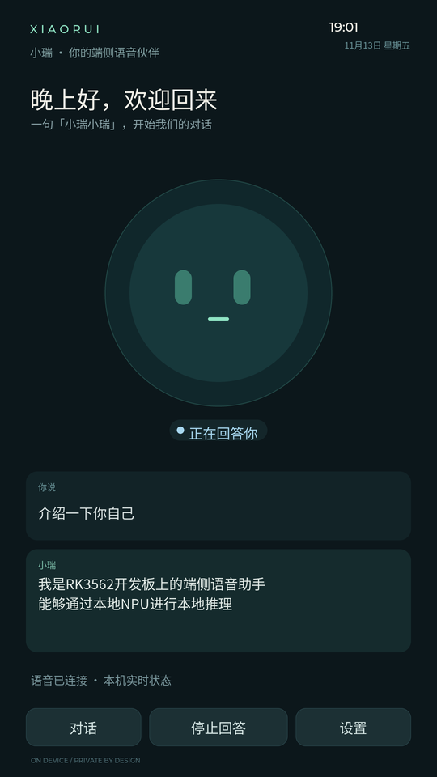
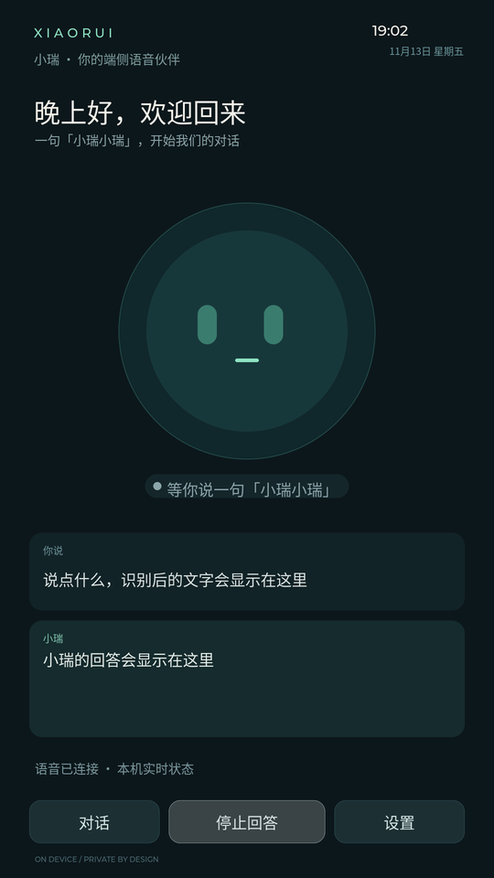
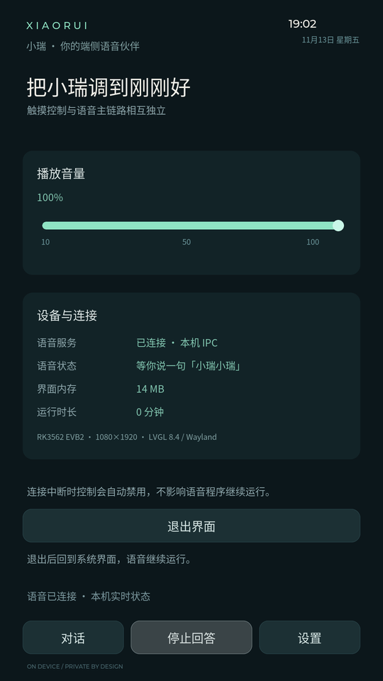

# 小瑞板载触摸界面（第一版）

独立 LVGL 8.4 进程，1080×1920 竖屏，通过现有 Weston/Wayland 的
xdg-shell 和 wl_shm 显示，触摸通过 Wayland seat 接收。
不接管 DRM、不读取 evdev，复用现有 Weston 和语音前端。

参考 `eqdrc` 的 LVGL 8.4/32-bit 色深、中文 FreeType 字体及布局经验。
没有复制其 Rockchip SDK 专有端口或独占 DRM 驱动。
LVGL 配套头文件与预编译库已随仓分发；它们的来源、许可和重建限制见
[`third_party/lvgl/README.md`](third_party/lvgl/README.md)。
具体清单见根目录 [THIRD-PARTY-NOTICES.md](../THIRD-PARTY-NOTICES.md)。

## 板端显示前提（2026-11-20 实机）

面板原生 **1080x1920 竖屏**，weston 必须显式指定该 mode，否则会挑 1920x1080
而 UI 直接退出（黑屏，语音却正常）：见 `ports/rk3562-es8388/weston.ini`
的 `[output] name=DSI-1 mode=1080x1920`。**不要用 `transform` 绕** —— 本板
weston 16 判 `transform=90` 为 Invalid，且不会交换逻辑几何。

## 界面截图

板端 1080×1920 实拍（`XR_UI_DUMP` 导出，缩到 540 宽）：

| 对话页（真实问答） | 待机（静音微光） | 设置页 |
| --- | --- | --- |
|  |  |  |

对话页来自 `XR_TEXT_INJECT=介绍一下你自己` 的真实一轮：问句卡片、分句字幕、随电平
变亮的眼睛都在；待机图是安静环境下的微光；设置页的连接状态、界面内存、运行时长
都是实时读出来的，音量条带 10/50/100 刻度。

## 功能边界

- 表情、时间、对话字幕卡片、对话/设置页、触摸导航。
- `--demo` 明确标为预览，所有语音控制禁用，不冒充真实状态。
- 正常模式等待本机语音 IPC；未连接或超过 2.5 秒无状态回包，停止/音量控件禁用。
- 前端启用 `XR_UI_SOCKET=/run/xiaorui/frontend.sock` 后，显示真实会话状态、
  ASR 问句与 TTS 分句字幕；音量复用软件增益，停止复用后端 abort。
- 设置页的“退出界面”关闭 UI，恢复 Weston 原界面，语音继续运行。

界面细节：状态用带色点的胶囊（按时钟/聆听/思考/回答四种颜色区分），眨眼是
平滑过渡、说话时轻微律动；回答卡片可上下滑动并自动跟到最新一句；“停止回答”
只在真正回答时可用，其余时间是灰的。

**麦克风电平**：前端把电平（相对底噪，0~100）随状态包一起上报，眼睛和光圈的
颜色跟着人说话变亮变暗；UI 每 100ms 问一次状态，电平才跟得上。

**设置页显示真实状态**：语音服务是否连接、当前语音状态、界面自身内存占用、
运行时长，都是实时读出来的，不是写死的文案；音量条加了 10/50/100 刻度和渐变。

顶栏带日期和按时段的问候语（跟板子语音里的问候呼应）；回答卡片的分句用换行
分隔，超出部分可上下翻（用户手动上翻后不再自动跟随）；“退出界面”要点两下，
3 秒不确认自动复原。

中文字体缺失时不再黑屏退出：退化成纯 ASCII 界面，说明缺哪个字体路径，语音照常
跑，界面仍可退出。

渲染只走脏区：LVGL 刷新的区域会被合并成一个矩形，只把这块拷进 shm 缓冲、
只损伤这块，合成器不用整屏重画。主循环改成阻塞等 wayland 事件（原来固定
10ms 空转，100Hz 唤醒），板上实测 UI 进程 CPU 从 0.7% 降到 0%。

## 构建

LVGL 8.4 的厂商分支头文件与 eqdrc 来源预编译库已随仓放在 `ui/third_party/lvgl/`
（头文件自报 8.4.0，32-bit 色深 + FreeType，许可及来源限制见同目录 README），
`ui/build.sh` 默认就用它，
不需要额外准备 SDK。要换别的同版本 SDK 时设 `XR_LVGL_ROOT`——库和 `lv_conf.h`
必须配套，不能只换库。PC 需要 wayland-scanner、Wayland 客户端开发头，交叉工具链
见 RK3562 复现说明。

```bash
export XR_TOOLCHAIN_ROOT=/path/to/aarch64-buildroot-toolchain
mkdir -p ui/build/deps
adb -s SERIAL pull /usr/lib/libwayland-client.so.0 ui/build/deps/
export XR_WAYLAND_LIBRARY="$PWD/ui/build/deps/libwayland-client.so.0"
bash ui/build.sh aarch64
```

xdg-shell XML 默认从交叉 sysroot 的 `usr/share/wayland-protocols/stable/xdg-shell/`
读取，也可设置 `XR_XDG_SHELL_XML`。由于旧工具链的 Wayland 过旧，生成绑定时使用
PC 的 Wayland 头文件并链接目标板客户端库；最终仍使用板上已有的 Wayland/FreeType，
不替换系统库。`--allow-shlib-undefined` 仅允许目标系统解析其已有动态库的传递依赖。

> ★ **XR_WAYLAND_LIBRARY 必须是 wayland >= 1.20 的库**（1.20 才引入
> `wl_proxy_marshal_flags`，旧版链接会报 undefined reference）。**不要用
> toolchain sysroot 自带的旧版** —— 上面的做法从板上 pull 一份，板上的版本
> 必然能跑 UI。2026-11-20 实测：sysroot 旧库链接失败，板上拉下来的库构建通过。

UI 部署到独立目录。真实语音控制还需通过 `build-board-live.sh`
构建并部署新版前端，在前端环境中设置 `XR_UI_SOCKET=/run/xiaorui/frontend.sock`。
本次停止功能还修复了网关的轮次取消，已有网关需要同步部署本仓新版 Python 文件。
UI 部署命令：

```bash
adb -s SERIAL shell 'mkdir -p /data/xiaorui-ui/lib'
adb -s SERIAL push ui/build/aarch64/xiaorui_ui /data/xiaorui-ui/
adb -s SERIAL push ui/build/aarch64/lib/liblvgl.so /data/xiaorui-ui/lib/
adb -s SERIAL push ui/run.sh /data/xiaorui-ui/
adb -s SERIAL shell 'sh /data/xiaorui-ui/run.sh'
```

## 开机自启与退出

RK3562 Buildroot 使用独立的 `S99xiaorui-ui`，在现有语音启动脚本之后运行，
最多等待 Wayland socket 20 秒。它不会停止 Weston 或管理语音进程。
重复启动不会新增 UI 进程，主动退出后不自动重启；下次开机重新打开。

```bash
adb -s SERIAL push ports/rk3562/S99xiaorui-ui /etc/init.d/S99xiaorui-ui
adb -s SERIAL shell 'chmod 755 /etc/init.d/S99xiaorui-ui'
adb -s SERIAL shell 'sh /etc/init.d/S99xiaorui-ui start'
adb -s SERIAL shell 'sh /etc/init.d/S99xiaorui-ui status'
```

屏幕上进入“设置”后点“退出界面”。通过 ADB 可执行
`sh /etc/init.d/S99xiaorui-ui stop`；再次打开用 `start`，重启界面用 `restart`。
取消开机自启时，将该脚本移到 `/data/xiaorui-ui/`，使其不再被 init 扫描。

中文字体默认复用板上思源黑体，不打包字体；可用 `XR_UI_FONT` 指定其他可读字体。
主机截图测试：`bash ui/build.sh native`，指定主机字体和 XML 后执行
`ui/build/native/xiaorui_ui --demo --snapshot /tmp/xiaorui.ppm`。
可加 `--settings` 直接预览设置页；主机 Wayland 库如需覆盖，使用
`XR_HOST_WAYLAND_LIBRARY`，与交叉构建的目标板库设置分开。
主机运行时回归测试用 `bash ui/test.sh`，沿用 native 构建的 LVGL/XML 环境变量；
可通过 `XR_UI_TEST_FONT` 指定主机中文字体。测试覆盖长回答滚动、手动翻阅后的跟随、
缺字体时的预览参数组合与退出确认。
运行期间设置 `XR_UI_DUMP=/tmp/xiaorui.ppm`，发送 SIGUSR1 可保存本进程画面；
不会截取其他应用或访问 DRM。

## 语音 IPC 契约

`board/ui_protocol.h` 定义本机 Unix datagram v1 协议，状态包固定 4376 字节，
含 magic、version、type、state、volume、level（麦克风电平）、UTF-8 question/answer
（均须 NUL 结尾）。
协议使用本机字节序，仅限同板 C 进程，不是网络 API。
UI 使用进程独有的 abstract socket，每 100ms 向 `XR_UI_SOCKET` 请求状态；
只采纳该路径返回的完整合法状态包。服务端目录须限制为语音进程/UI 用户可访问。
UI 不建立、删除或覆盖服务端 socket。
追加的 TTS 音量消息沿用相同 v1 包结构：type 6 设置增益(通过 `volume` 字段)，
type 7 查询、type 8 返回当前增益。旧 UI 会忽略这两个新状态消息，既有音乐/语音总音量
控制和字幕状态包不变。

前端只在最近 2 秒内有 UI 客户端问过状态时才把云端轮询降到 50ms，
没有 UI 时回到 1000ms（UI 出现之前的行为），回答期不必 20Hz 空转。

服务端在语音线程中非阻塞处理 QUERY/VOLUME/STOP，音频排空期间继续轮询。
状态和字幕来自会话事件，不解析日志；字幕是已解码的 UTF-8 明文（网关的
`\uXXXX` 转义在后端解好，IPC 这层不再传 JSON），回答分句之间用换行分隔，
字幕容量有限（回答 4096 字节），超出的按 UTF-8 字符边界截断。

字幕只在"这一轮的第一段内容"到达时才清上一轮：噪声触发、又被网关丢掉的
轮次不会把用户刚问的和刚答的擦掉。
目录权限为 0700，socket 为 0600，并校验发送者 UID；UI 与前端应使用同一用户。
异常退出后自动回收遗留 socket，拒绝覆盖仍活跃的服务端或普通文件。
未设置 `XR_UI_SOCKET` 时不启用服务端；连接失败不阻止语音工作。
停用 UI 只需退出 UI 进程；停用 IPC 则删除前端环境变量并重启前端。
